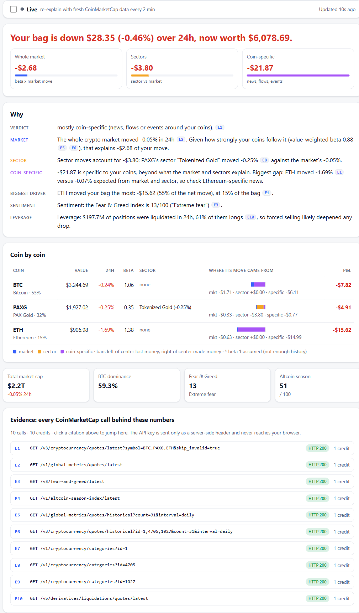
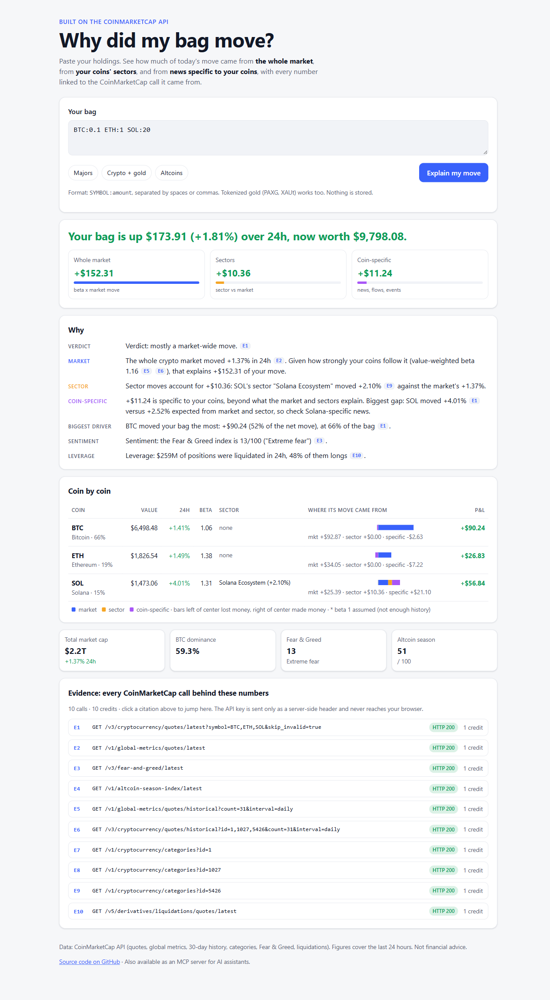
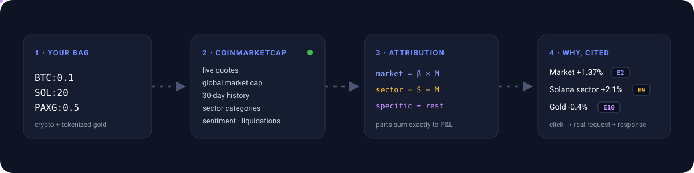
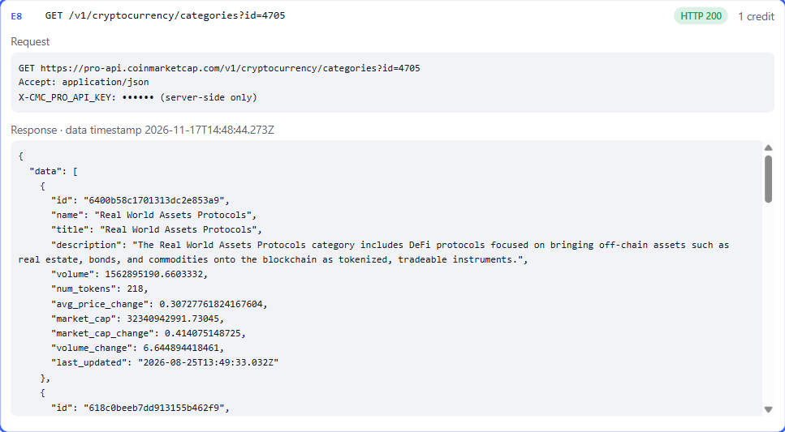

<div align="center">

<a href="https://why-did-my-bag-move.vercel.app"></a>

<br>

<a href="https://why-did-my-bag-move.vercel.app"></a>
<a href="https://youtu.be/UGV9SjfyvrM"></a>


<br>


<h3>
  <a href="https://why-did-my-bag-move.vercel.app">Try it live</a>
  ·
  <a href="https://youtu.be/UGV9SjfyvrM">Watch the demo</a>
  ·
  <a href="#how-it-works">How it works</a>
  ·
  <a href="#coinmarketcap-endpoints-used">CMC endpoints</a>
  ·
  <a href="#mcp-server">MCP server</a>
  ·
  <a href="FEEDBACK.md">API feedback</a>
</h3>

</div>

---

## The problem

> *"My portfolio is down 4% today. Was that the whole market? My coins' sector? Or news about one coin I hold?"*

Price apps show **what** moved, but not **why**. Traders and investors usually piece this together by hand across several tabs. **Why did my bag move?** answers it in one click, and shows its work.

## What it does

Paste holdings like `BTC:0.1 ETH:1 SOL:20 PAXG:0.5` and get:

| You get | Details |
|---|---|
| **Your 24h P&L** | Per coin and in total, from live CoinMarketCap prices |
| **Market part** | `beta × whole-market move`, with beta measured from the last 30 days |
| **Sector part** | The coin's sector vs the market, auto-picked from CMC categories, e.g. *Solana Ecosystem* or *Tokenized Gold* |
| **Coin-specific part** | Whatever is left over: news, flows or events about that coin |
| **Plain-English "why"** | A verdict, the biggest driver, Fear & Greed sentiment and liquidation pressure |
| **A citation on every number** | Click `E2` to see the exact request and the **real CMC response** behind it |
| **Live mode** | Re-explains your bag every 2 minutes with fresh data, showing how much it changed since the last update |

The three parts **add up exactly** to each coin's P&L. **No AI model is involved:** the explanation comes from deterministic, tested math, so it is free to run and cannot invent numbers. The move itself always uses **live** data, and the 30 days of history only measure each coin's sensitivity to the market (beta).

<div align="center">

<br><sub><b>A real down day (17 Nov 2026):</b> the bag fell $28, mostly coin-specific: ETH −1.69% against −0.07% expected. PAXG's sector is <i>Tokenized Gold</i>. Every figure links to its CMC call.</sub>
</div>

<details>
<summary><b>Example on an up day (text output)</b></summary>

> **Your bag is up $173.91 (+1.81%) over 24h, now worth $9,798.08.**
> - Verdict: mostly a market-wide move. [E1]
> - The whole crypto market moved +1.37% in 24h [E2]. Given how strongly your coins follow it (value-weighted beta 1.16 [E5] [E6]), that explains +$152.31 of your move.
> - Sector moves account for +$10.36: SOL's sector "Solana Ecosystem" moved +2.10% [E9] against the market's +1.37%.
> - +$11.24 is specific to your coins. Biggest gap: SOL moved +4.01% [E1] versus +2.52% expected from market and sector, so check Solana-specific news.
> - Sentiment: the Fear & Greed index is 13/100 ("Extreme fear") [E3].
> - Leverage: $259M of positions were liquidated in 24h, 48% of them longs [E10].


</details>

### Three ways to use it, one codebase

| | Surface | How to use it |
|---|---|---|
| | **Web app** | **https://why-did-my-bag-move.vercel.app**, or `npm run dev` locally |
| | **MCP server** for AI assistants (Claude Desktop, Cursor, ...) | `npm run mcp`, see [MCP server](#mcp-server) |
| | **Command line** | `npm run explain -- BTC:0.1 SOL:20` |

## How it works

<div align="center">

</div>

---

## CoinMarketCap endpoints used

Every endpoint below is called with a real key, and its real response is saved in [`samples/`](samples/) (see [`samples/ENDPOINTS.md`](samples/ENDPOINTS.md)). All core features work on the **free Basic plan**, so the demo keeps working after the hackathon's free Startup upgrade ends.

| Endpoint | Used for | Credits per call |
|---|---|---|
| `GET /v3/cryptocurrency/quotes/latest` | Live price, 24h change and market cap for every holding (one call for all coins) | 1 |
| `GET /v1/global-metrics/quotes/latest` | Whole-market 24h change (total market cap), BTC dominance | 1 |
| `GET /v3/cryptocurrency/quotes/historical` | 30 daily prices per coin (one call for all coins), used for beta | 1-2 |
| `GET /v1/global-metrics/quotes/historical` | 30 daily total-market-cap points, used for beta | 1 |
| `GET /v1/cryptocurrency/categories` | Each coin's sectors and their 24h change | 1 per coin |
| `GET /v3/fear-and-greed/latest` | Market sentiment | 1 |
| `GET /v1/altcoin-season-index/latest` | Altcoin season context | 1 |
| `GET /v5/derivatives/liquidations/quotes/latest` | Long vs short liquidations (leverage context) | 1 |
| `GET /v5/real-world-assets/quotes/latest` | Tokenized real-world asset prices (MCP tool `get_rwa_quotes`) | 1 |
| `GET /v1/key/info` | Free key check during `npm run setup` | 0 |
| `GET /v1/cryptocurrency/map` | Symbol-to-id check during the endpoint probe | 0 |

A full explanation of a 3-4 coin portfolio makes about 10 calls and costs about 10 credits, or 0 when served from cache. These endpoints were also probed but **are not used**, because they return `403 / 1006` on the Basic plan: `trending/latest`, `trending/gainers-losers` and `price-performance-stats/latest`.

### Evidence of a real API call

The request the app makes (the key goes only in the header, server-side):

```bash
curl -H "X-CMC_PRO_API_KEY: $CMC_PRO_API_KEY" -H "Accept: application/json" \
  "https://pro-api.coinmarketcap.com/v3/fear-and-greed/latest"
```

The real response, saved in [`samples/fear-and-greed-latest.json`](samples/fear-and-greed-latest.json):

```json
{
  "data": { "value": 13, "update_time": "2026-11-17T13:38:10.018Z", "value_classification": "Extreme fear" },
  "status": { "timestamp": "2026-11-17T13:41:42.340Z", "error_code": "0", "error_message": "", "elapsed": 4, "credit_count": 1 }
}
```

Inside the app, every explanation ends with an **Evidence** panel listing each call: method, URL, HTTP status, credits, whether it came from cache, and the raw response. The key is never shown:

<div align="center">

</div>

---

## Quick start

Requirements: Node.js 20 or newer, and a free CoinMarketCap API key from https://pro.coinmarketcap.com/account (the Basic plan is enough).

```bash
git clone https://github.com/parthpawar1117/why-did-my-bag-move.git
cd why-did-my-bag-move
npm install
npm run setup      # creates .env, opens it so you can paste your key, checks the key, probes every endpoint
npm run dev        # http://localhost:3000
```

Prefer to set it up by hand? Copy `.env.example` to `.env` and set `CMC_PRO_API_KEY=...`.

| Command | What it does |
|---|---|
| `npm run dev` / `npm run build` / `npm start` | Web app (Next.js) |
| `npm run explain -- BTC:0.1 SOL:20` | Explain a portfolio in the terminal (add `--json` for the full report) |
| `npm run mcp` | Start the MCP server on stdio |
| `npm run mcp:smoke` | End-to-end check: starts the MCP server and calls it live |
| `npm run probe` | Call every endpoint and save real responses to `samples/` |
| `npm run verify` | Secret scan, type-check, lint and all tests |

---

## MCP server

The same tools are exposed over the [Model Context Protocol](https://modelcontextprotocol.io), so an AI assistant can answer "why did my bag move?" with cited CMC data.

| Tool | What it returns |
|---|---|
| `explain_portfolio_move` | The full attribution and explanation for a list of `{symbol, amount}` holdings |
| `get_quotes` | Live price and 1h/24h/7d/30d change, resolving look-alike tickers to the right coin |
| `get_market_context` | Total market cap and 24h change, BTC dominance, Fear & Greed, Altcoin Season |
| `get_coin_sectors` | A coin's CMC categories with their average and market-cap changes |
| `get_liquidations` | Long and short liquidations over 1h, 4h and 24h |
| `get_rwa_quotes` | Tokenized real-world asset prices (gold, silver, ...) |

Every tool result is `{ data, evidence }`, where `evidence` lists the CMC calls behind the data. All tools are read-only.

**Claude Desktop** (`claude_desktop_config.json`):

```json
{
  "mcpServers": {
    "why-did-my-bag-move": {
      "command": "npm",
      "args": ["run", "-s", "mcp", "--prefix", "/absolute/path/to/why-did-my-bag-move"],
      "env": { "CMC_PRO_API_KEY": "your-cmc-api-key-here" }
    }
  }
}
```

On Windows, use `"command": "npm.cmd"`. The `-s` flag matters: it keeps npm's banner off stdout, which carries the MCP messages. If `env` is omitted, the server reads the key from the project's `.env`.

---

## Architecture

```
app/                     Next.js app router: page, layout, POST /api/explain
src/cmc/client.ts        Typed CMC client: error kinds, evidence ledger (E1, E2, ...)
src/cmc/cache.ts         Fresh cache + stale fallback on 429/5xx/network, shared in-flight calls
src/cmc/resolve.ts       Picks the right coin when several share a ticker
src/engine/beta.ts       30-day beta from daily returns
src/engine/sector.ts     Picks one meaningful sector from CMC categories
src/engine/attribution.ts  Market / sector / coin-specific split (pure math)
src/engine/narrative.ts  Rule-based plain-English explanation with citations
src/engine/explain.ts    Orchestrates the CMC calls into one report
src/tools/               Tool registry shared by the MCP server and the web app
src/mcp/                 MCP server (stdio)
src/web/                 API handler, rate limiter, React UI
tests/                   91 tests, most run against real saved CMC responses
samples/                 Real CMC requests and responses (key removed)
```

**The attribution math**, for a coin with 24h change `r`, beta `b`, whole-market change `M` and sector change `S`:

```
market   = b × M
sector   = S − M          (0 if no meaningful sector)
specific = r − market − sector
```

Each part in dollars is `value 24h ago × part / 100`, so the parts add up exactly to the coin's P&L, and the coins add up to the portfolio's.

**Picking a sector.** CMC categories mix real sectors with trivia. The picker skips:
- trivia lists such as VC portfolios, "FTX Bankruptcy Estate" and "Alleged SEC Securities";
- lists so broad they are basically the whole market ("Binance Ecosystem" holds about 100% of total market cap);
- another chain's ecosystem (ETH sits inside "Sophon Ecosystem");
- categories the coin itself dominates.

It then takes the most specific category left. When nothing qualifies, the coin gets no sector, and its move is split only between market and coin-specific.

### Reliability: built for the judging period

- **Basic-plan only.** Every core endpoint works on the free plan, so nothing breaks when the hackathon Startup tier ends.
- **Graceful degradation.** Only the live quotes call is required. History (beta), sectors, sentiment and liquidations are optional: if one is rate-limited or not on the plan, the explanation still runs and a note says what was skipped. Coins without history fall back to beta 1, and the app says so.
- **Caching.** Live data is cached for 60 s, history and sectors for 1 h. When CMC returns 429/5xx or is unreachable, the last good answer (up to 24 h old) is served and **labelled stale** in the evidence. Plan and auth errors are never hidden behind old data.
- **Rate limiting.** Each visitor gets 6 explanations per minute, with 20 per minute overall, which protects the credit budget and the 50 calls/minute Basic limit. The page also waits out a 429's `Retry-After` (the button shows "Wait 31s") and never sends two requests less than 2 s apart, so rapid clicking cannot hammer the API.

### Security

- The API key lives only in `.env` (gitignored) or in a Vercel secret. `.env.example` holds a placeholder.
- The browser never talks to CMC. The key is sent only as a server-side `X-CMC_PRO_API_KEY` header, and it never appears in URLs, evidence, logs or error messages (tested).
- `npm run check:secrets` scans every file git would commit for key-shaped strings, and runs as part of `npm run verify`.

### Testing

```bash
npm run verify   # secret scan, tsc --noEmit (strict), eslint, 91 vitest tests
```

Most tests replay **real CMC responses** from `samples/` instead of hand-written mocks. That is how the API quirks listed in [FEEDBACK.md](FEEDBACK.md) were found. The MCP server is tested end to end through an in-memory MCP client, and `npm run mcp:smoke` checks it live over stdio.

---

## Limitations

- **The windows don't line up exactly.** CMC's coin `percent_change_24h` and the global `total_market_cap_yesterday_percentage_change` are computed by CMC at slightly different times, so the market part is an estimate.
- **Beta is a 30-day estimate.** It is clamped to between -1 and 4 so one odd month cannot produce absurd figures.
- **Sector picking is a heuristic,** because CMC has no single official sector per coin.
- **Rate limits and cache are per server instance** (in memory). That is fine for a demo, while a production deployment would use a shared store.
- **Real-world assets use their tracking tokens.** RWA quotes have no 24h change field, so tokenized gold enters a portfolio as its token (PAXG, XAUt).
- **This is not financial advice.**

## Feedback on the API

What the API made possible, and where it got in the way: see **[FEEDBACK.md](FEEDBACK.md)**.

## License

[MIT](LICENSE)
